# AVA Vanguard

[](https://github.com/Harlock123/AVAVanguard/actions/workflows/build.yml)

A cave-flying shooter in the style of SNK's 1981 arcade game **Vanguard**, built with .NET 10 and
Avalonia UI. Fly a fighter with four guns, ahead, behind, up and down, through a cave that scrolls on by
itself. Pass through five zones, each with its own rock and its own enemies, to the Citadel at the end,
where the Warden waits behind its turning shield. Fuel burns all the time, and the only way to get more
is to destroy things. Fly into a charge pod and for a few seconds you can ram straight through them.

## Features

- **Your ship**:
  - **Flying:** it goes anywhere on the left part of the screen. The cave scrolls on by itself, quicker when you push forward.
  - **Four guns:** a long streak ahead or behind, a short bolt up or down, six shots at most in the air. The rock stops them.
  - **The rock:** touching the ceiling or the floor destroys the ship.
  - **Fuel:** it burns all the time. Destroying things puts some back; run out and the ship is lost.
  - **Charge pods:** fly into one to surge for seven seconds, to a fanfare. Nothing but the rock can hurt the ship, and it destroys everything it touches, each one worth twice the last (100, 200, 400 and so on).
- **The five zones**:
  - **Spire zone:** open sky over sharp peaks. Darters weave in, and Rockets launch off the peaks as you pass.
  - **Band zone:** a striped tube winding up and down. Coilers bounce from wall to wall, and Mines hang in the way.
  - **Barren zone:** a jagged, winding cave with Turrets on its ceiling and floor, and Harriers hunting you from behind.
  - **Prism zone:** rainbow strata under open sky, where chains of Swarmers snake through.
  - **The Citadel:** a passage of blocky masonry with a bit of everything, ending at the Warden's chamber.
  - **Between zones:** each new zone pays a bonus of ten points for each unit of fuel left, then fills the tank.
- **The Warden**: a great eye that follows your ship, behind a turning ring of shield blocks.
  - **The shield:** each block takes three hits, and there are gaps in the ring.
  - **The eye:** shoot it fourteen times through the gaps. Meanwhile it fires fans of shots and sends out Harriers.
  - **Beating it:** 5,000 points times the round. Then the next round begins at the Spire zone, quicker.
- **Losing a ship**: the next one comes back a little way before where you were, in the middle of the passage, with a full tank and a moment's safety. It never goes back before the start of the zone.
- **Scoring**:

  | | Points |
  |---|---|
  | Mine | 30 |
  | Darter | 50 |
  | Swarmer | 60 |
  | Rocket | 80 (100 in the air) |
  | Coiler | 100 |
  | Harrier | 150 |
  | Turret | 200 |
  | Rammed while surging | 100, 200, 400 ... up to 3,200 |
  | A Warden shield block / its eye | 10 a hit, 50 to break / 100 a hit |
  | The Warden | 5,000 times the round |

  - **Extra ships** come at 10,000 and every 30,000 after that.
- **The score bar**: the fuel gauge, the surge's charge, and a map of the five zones showing how far you've come.
- **Sound**:
  - **The tunes:** an original heroic anthem in G for the title, and a quick march while the ship surges.
  - **The effects:** the guns, explosions, rockets launching, the low-fuel alarm, the surge charging and fading, the clang of each ram, the Warden's shield and its cry, and the cave's drone.
  - All of it is synthesised and mixed by OpenAL.
- **Attract mode**: leave the title alone for 15 seconds and a computer pilot plays. It keeps to the safe part of the passage, dodges shots, flies into charge pods and rams, and fires whichever gun points at something.
- **A top-ten high-score table** with arcade-style initials entry. It records the zone reached.
- **Gamepads** through SDL2, as well as the keyboard.
- **Any window size**: the screen scales to fit, letterboxed. **Ctrl+S** saves a screenshot.
- **One self-contained executable** per platform: Windows, macOS and Linux on Intel/AMD and ARM.

## Screenshots

| The title | Spire zone | Band zone |
|:---------:|:----------:|:---------:|
| 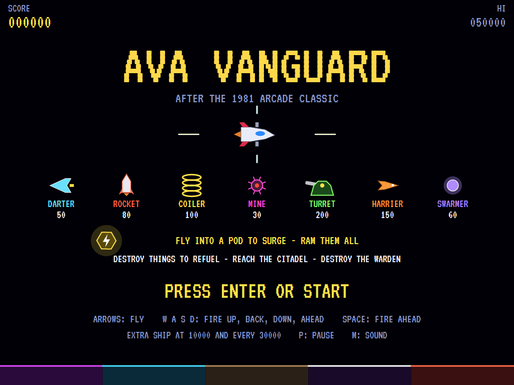 | 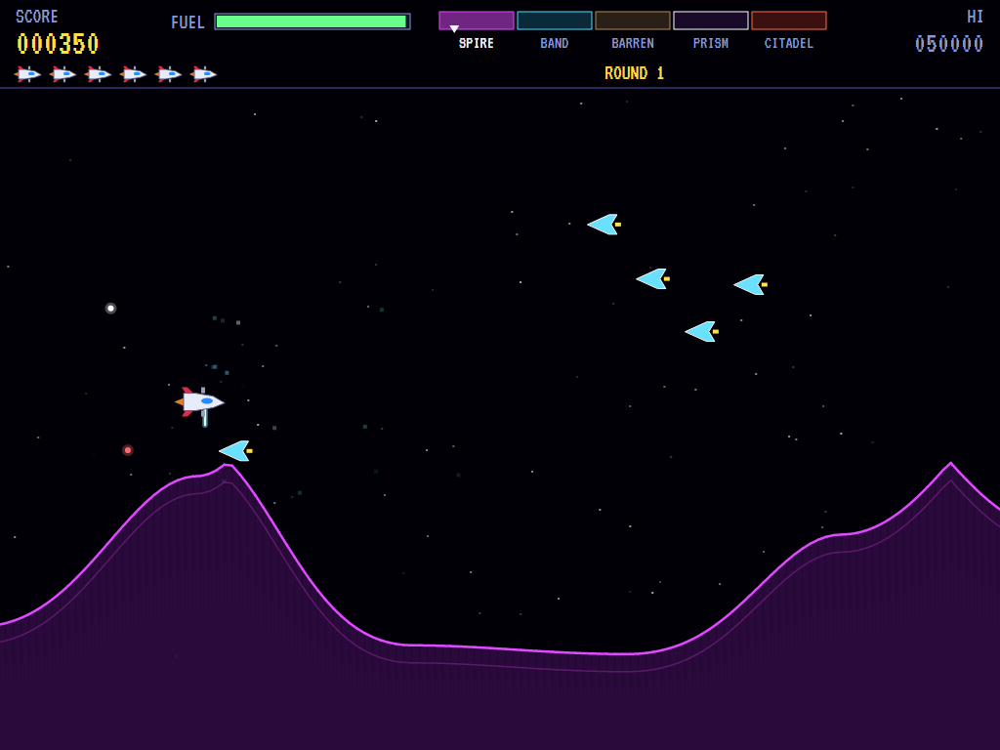 | 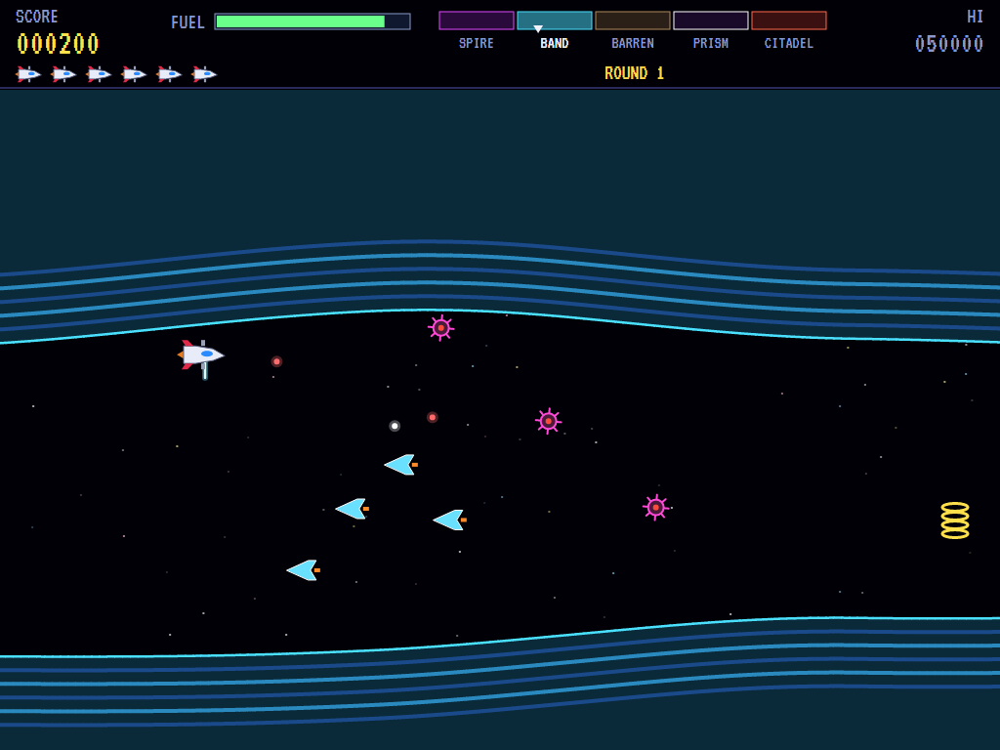 |
| The enemy, and what they're worth. | Darters over the peaks. | Coilers and Mines in the tube. |

| Barren zone | Prism zone | The Citadel |
|:-----------:|:----------:|:-----------:|
| 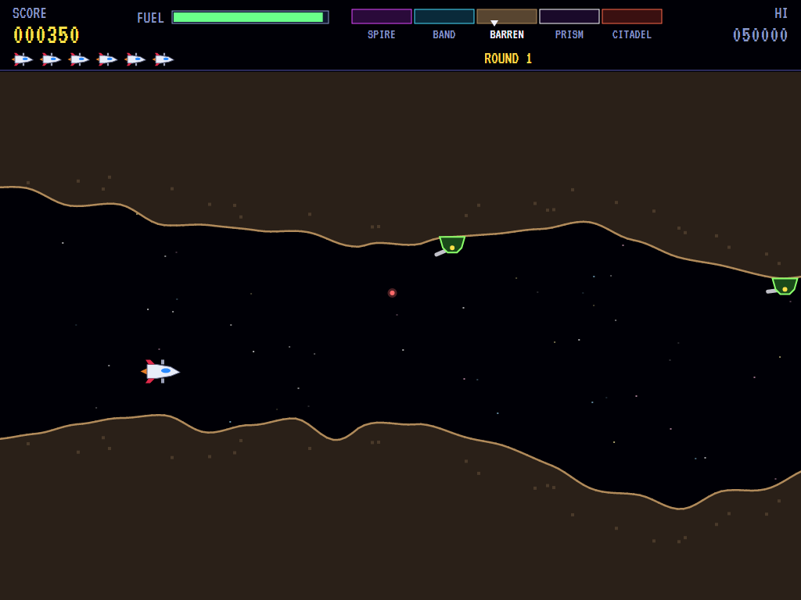 | 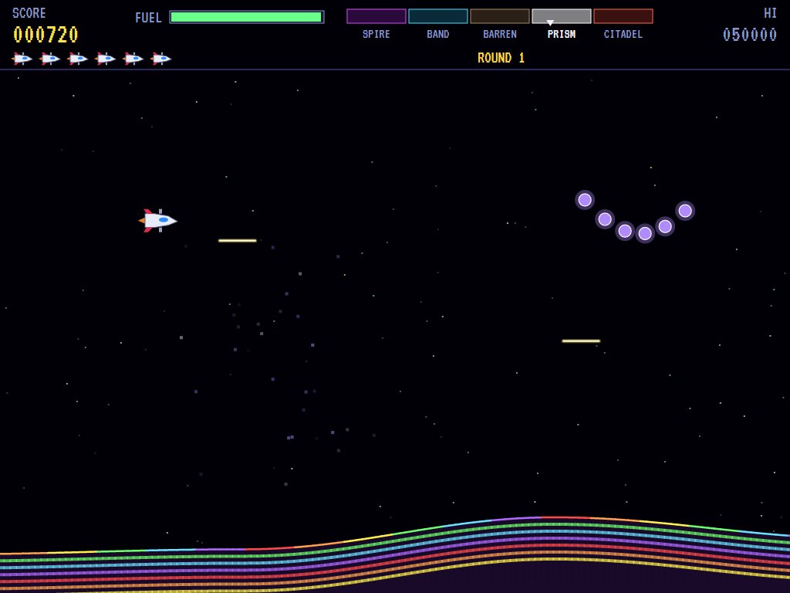 | 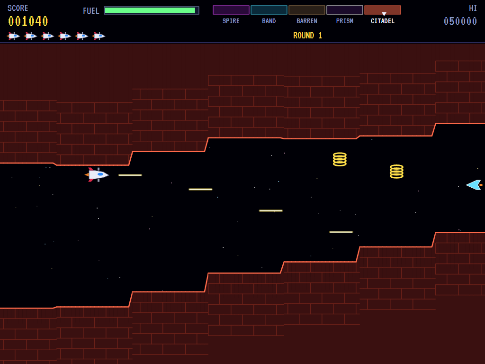 |
| Turrets on the ceiling. | A chain of Swarmers. | Masonry walls. |

| A surge | The Warden | The Warden falls |
|:-------:|:----------:|:----------------:|
| 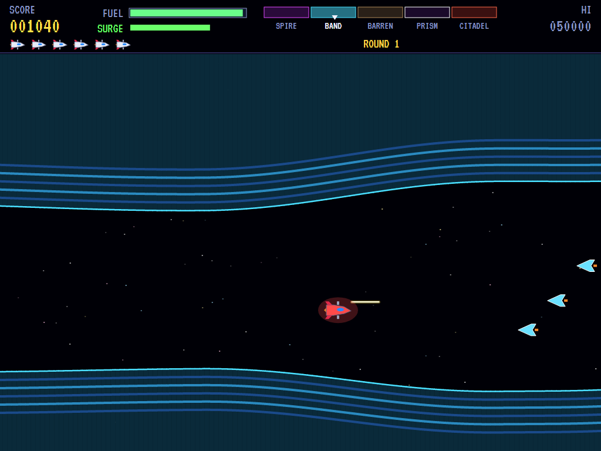 | 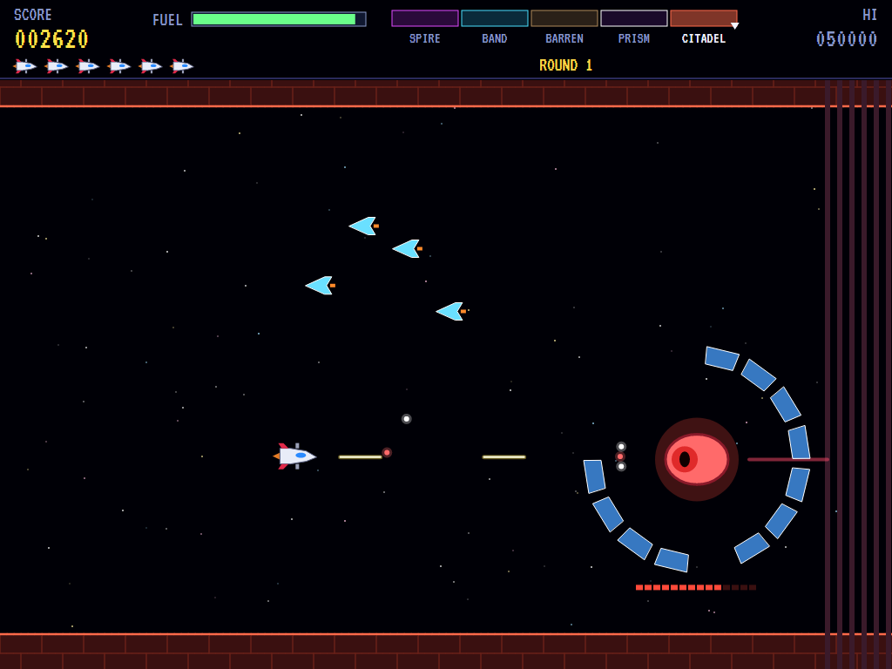 | 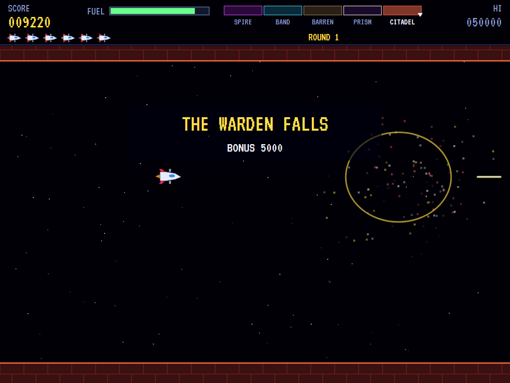 |
| Charged: ram them all. | Shooting through the gaps in its ring. | The round's bonus. |

| Shot down | The high scores | |
|:---------:|:---------------:|:-:|
| 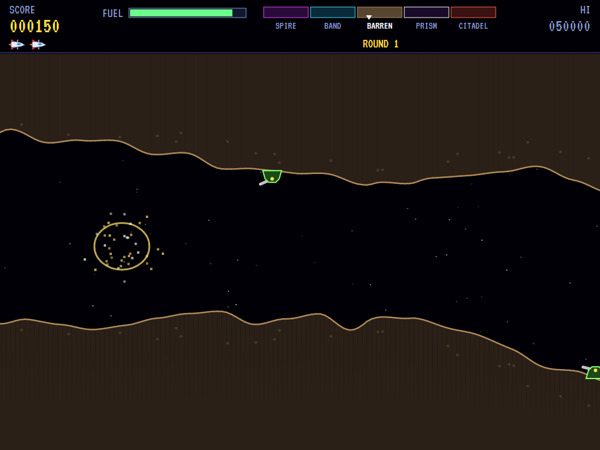 | 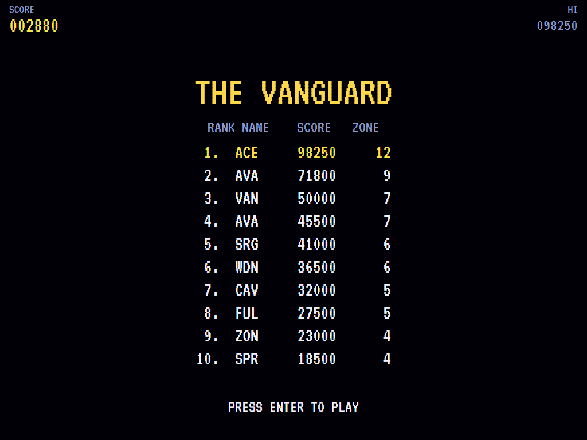 | |
| One shot too many. | The high-score table. | |

The screenshots are made by the tests, which play the game in a real (headless) window; see
[Tests](#tests).

## Download and run

Ready-to-run builds for Windows, macOS and Linux, on both Intel/AMD and ARM, are on the
[Releases page](https://github.com/Harlock123/AVAVanguard/releases/tag/latest). **Latest build** is
rebuilt on every push to `main`. Each download is one self-contained executable: no .NET install is
needed.

| Platform | Archive |
|---|---|
| Windows | `AVAVanguard-win-x64.zip`, `AVAVanguard-win-x86.zip`, `AVAVanguard-win-arm64.zip` |
| macOS | `AVAVanguard-osx-arm64.tar.gz` (Apple silicon), `AVAVanguard-osx-x64.tar.gz` (Intel) |
| Linux | `AVAVanguard-linux-x64.tar.gz`, `AVAVanguard-linux-arm64.tar.gz`, `AVAVanguard-linux-arm.tar.gz` |

```bash
tar -xzf AVAVanguard-linux-x64.tar.gz     # or linux-arm64, linux-arm, osx-arm64, osx-x64
./AVAVanguard
```

On Windows, unzip and run `AVAVanguard.exe`. On macOS, if Gatekeeper refuses to open it, run
`xattr -d com.apple.quarantine AVAVanguard` once. Run with `--no-audio` for silence.

**Sound** comes through OpenAL Soft, built in for every platform. In a virtual machine the game
detects it and uses a larger audio buffer, so the sound doesn't break up.

**Gamepads** use SDL2, which is bundled for Windows, macOS and Intel/AMD Linux. ARM Linux builds need it
installed; without it the keyboard still works:

```bash
sudo apt install libsdl2-dev            # Debian / Ubuntu / Raspberry Pi OS
sudo pacman -S --needed sdl2-compat     # Arch / Omarchy
```

## Controls

| Input | Action |
|-------|--------|
| **Enter** | Start |
| **Arrow keys** | Fly |
| **D** / **L** / **Space** / **Ctrl** | Fire ahead |
| **A** / **J** | Fire behind |
| **W** / **I** | Fire up |
| **S** / **K** | Fire down |
| **P** / **Esc** | Pause (Esc again to quit) |
| **M** | Mute |
| **Ctrl+S** / **Cmd+S** | Save a screenshot to the Pictures folder |

Hold a gun's key to keep it firing. Aiming ahead or behind takes precedence over up or down.

**Gamepad**: left stick or D-pad to fly. The face buttons fire the four guns: **B** ahead, **X** behind,
**Y** up and **A** down. The right stick also fires the way it's pushed, and the right trigger fires
ahead. **Start** starts and pauses; **Back** (while paused) quits.

**Entering initials**: type letters, or dial with **Up**/**Down** and accept with **Space**; **Left** /
**Backspace** go back; **Enter** finishes.

## Tests

```bash
dotnet test AVAVanguard.slnx
```

The engine has no UI and runs in fixed 60 Hz steps, so it plays the same at any frame rate, and a seed
always plays the same game. The tests check:

- **The ship:**
  - flying about the left of the screen
  - the cave scrolling by itself, quicker when you push forward
  - the rock destroying the ship
  - each gun firing its own way and hitting what's there
  - six shots at most, and the rock stopping them
  - fuel burning, refuelling, and running out
  - surging, ramming for doubling points, and wearing off
  - the rock still destroying a surging ship
- **The enemy:**
  - Rockets launching as you near, and being worth more in the air
  - Coilers bouncing
  - only what's on the screen firing
  - Harriers coming from behind
  - Swarmers following each other's path
  - each zone sending its own kinds
- **Zones and the Warden:**
  - the fuel bonus between zones
  - the cave stopping at the Warden
  - its shield, its eye, and the next round beginning
- **Losing ships:**
  - going back a little, refuelled, but never before the zone
  - coming back in the middle of the passage
  - the last ship ending the game
  - extra ships
- **The machine:** the attract cycle, the computer pilot getting through the first zones, the same game from the same seed, and pausing

The screenshot tests draw the real screen in a headless window. To refresh the README's pictures:

```bash
VANGUARD_SHOTS=$PWD/Images dotnet test tests/AVAVanguard.Tests --filter ScreenshotTests
```

To see how the computer pilot gets on, zone by zone (for tuning), or how a player who just sits and fires
ahead does (`VANGUARD_PROBE=lazy`):

```bash
VANGUARD_PROBE=1 dotnet test tests/AVAVanguard.Tests --filter PilotProbe --logger "console;verbosity=detailed"
```

## Building

```bash
dotnet build AVAVanguard.slnx
dotnet run --project src/AVAVanguard
```

Needs the .NET 10 SDK. The sounds are made by `tools/make_sounds.py` (standard-library Python):
`python3 tools/make_sounds.py` rewrites `src/AVAVanguard/Sounds`.

## Project structure

```
AVAVanguard/
├── AVAVanguard.slnx
├── src/AVAVanguard/
│   ├── Engine/
│   │   ├── GameEngine.cs        # States, the title and demo cycle, and the cave's drone
│   │   ├── GameEngine.Play.cs   # The ship, its four guns, fuel and surges; the enemy; zones,
│   │   │                        # the Warden, and scoring
│   │   ├── ShipPilot.cs         # The computer pilot, for the demonstration (and the tests)
│   │   ├── Entities.cs          # The cave and its five zones' walls, the ship, shots, enemies, pods,
│   │   │                        # and the Warden
│   │   ├── HighScoreTable.cs, InitialsEntry.cs
│   │   ├── InputHandler.cs, ControllerManager.cs  # Keys and an SDL2 gamepad
│   │   └── SoundManager.cs      # Effects and the tunes through OpenAL
│   ├── Audio/                   # The OpenAL engine (from the author's AVABand)
│   ├── Views/                   # The cave, the ship, the enemy, the Warden, the score bar and screens
│   └── Sounds/                  # The synthesised effects and tunes
├── tests/AVAVanguard.Tests/     # Gameplay, screenshot and probe tests
├── tools/make_sounds.py
└── Images/                      # Screenshots
```

## About and licence

AVA Vanguard © 2026 Lonnie Watson, under the [MIT License](LICENSE).

*Vanguard* © 1981 SNK; the name belongs to its current owner. AVA Vanguard is an independent, unofficial
game in its style. Its ship, its zones, its Darters, Rockets, Coilers, Mines, Turrets, Harriers and
Swarmers, its Warden, its graphics, sounds, tunes and code are its own; nothing is taken from the arcade
machine's program, graphics, sound or music. It is not affiliated with or endorsed by any rights holder.
